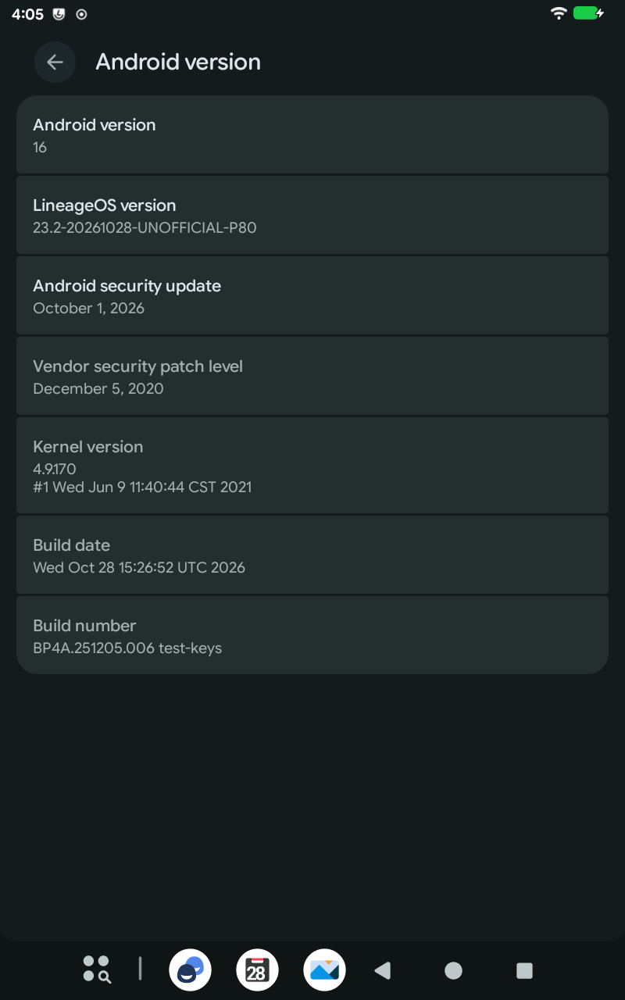

# LineageOS 23.2 for the Teclast P80 (G3M2) — unofficial

Unofficial builds of **LineageOS 23.2 (Android 16)** for the **Teclast P80** tablet, variant **G3M2** (Allwinner A133, 2 GB RAM, 8″ 800×1280).
This project is not affiliated with LineageOS or Teclast.

Teclast never updated the P80 beyond Android 10 with the December 2020 security patch, and it does not publish the tablet's kernel source, so a regular LineageOS device port is not possible.
The tablet supports Project Treble, though: this build replaces only the Android system and keeps Teclast's kernel and vendor partition (the drivers).
It is LineageOS with the [TrebleDroid](https://github.com/TrebleDroid) compatibility layer, built after the recipe of [MisterZtr's LineageOS_gsi](https://github.com/MisterZtr/LineageOS_gsi), and carries the fixes this tablet needs as patch files (`patches/lineage-23.2/`), applied at build time.
Everything runs in a Podman container, so the host only needs Podman and disk space.

How it started: my P80 was stuck on Android 10 with the 2020 security patch, and with the help of [Claude](https://claude.ai) (Anthropic's AI assistant, used through Claude Code) it got a current system.
Claude did most of the porting work — finding out why ready-made images did not work on this tablet, writing the patches and this documentation — while I tested on the tablet.

<p align="center">
  
</p>

## Which tablet

Only the **P80 G3M2**, sold from late 2020 with Android 10.
The product ID is printed on the label on the back or on the box, and `adb shell getprop ro.product.device` shows it too (`P80_G3M2_EEA` on the tablet this was tested on).

Teclast used the name P80 for several different tablets. **Do not flash this on any other variant**: the P80 G3M3 (A133 as well, but another manufacturer's board with other display panels, touch and cameras; Android 11 firmware), the P80X (Unisoc SC9863A), the P80T (A133, 3 GB, Android 12) or the older P80 3G / P80h (MediaTek).
The G3M6 product ID may be the same hardware as the G3M2 but has not been tested.

## Status

Tested on one P80 G3M2 (EEA) with Teclast's latest firmware, V1.04 (2021-06-09).

| Feature | Status |
| --- | --- |
| Boot, display, touch, setup wizard | Works (about 75 s from power-on to the lock screen) |
| Wi-Fi | Works, 2.4 and 5 GHz (WPA3-only networks are not shown, see below) |
| Bluetooth | Works, also while the tablet sleeps |
| Audio | Works (speaker) |
| Cameras | Work (rear: photos and 720p video; front: VGA) |
| Graphics | Hardware rendering and composition (PowerVR GE8300) |
| Video playback | Hardware decoding through Teclast's codecs (H.264 tested) |
| Sensors | Accelerometer and auto-rotate (the tablet has no other sensors) |
| Charging, battery, deep sleep | Work. Standby with the screen off and Wi-Fi and Bluetooth on: about 1.3 % per hour, roughly three days from a full charge |
| SELinux | Enforcing |
| Not tested yet | microSD card, magnetic cover (hall sensor), wired headphones, battery life in daily use |

### Known limitations

- **The kernel and the vendor partition stay Teclast's**: Linux 4.9.170 from June 2021 and the vendor security patch level of December 2020.
  The Android security update shown in Settings covers the LineageOS system only; bugs in the kernel and in Teclast's drivers are not fixed.
- **WPA3-only Wi-Fi networks are not shown**: the Wi-Fi chip's driver (Unisoc UWE5622) has no WPA3 support. Use WPA2, or the router's WPA2/WPA3 transition mode.
- **Adaptive brightness cannot work**: the tablet has no light sensor.
- **The tablet does not sleep while it is connected to a computer** (USB with data): Teclast's USB driver keeps it awake. A charger is fine.
- **Set the time zone yourself**: without a mobile network or Google's location services Android cannot detect it, and the setup wizard's date and time page preselects the first zone of its list, Midway (UTC−11).
  Pick yours there, or later in Settings → System → Date & time (turn off **Set time zone automatically** first).

## Download

There are no regular releases.
[Releases](https://github.com/6Xkljk8Vj7Tk1k4/lineageos-p80-builder/releases) has one **proof-of-concept build** for trying it: `lineage-23.2-YYYYMMDD-UNOFFICIAL-P80.img.xz`, `empty-product.img` and `SHA256SUMS`.
Unpack the image before flashing (`xz -d`, or 7-Zip on Windows); it is about 2.3 GB.
`SHA256SUMS` lists the downloads and the unpacked image; on Linux `sha256sum -c --ignore-missing SHA256SUMS` checks whichever of them are present.

It is signed with the public AOSP test keys, like most unofficial builds: anyone can sign an app or an update with those keys and the tablet trusts it, and an app signed with the public platform key even gets system privileges.
Signing with your own keys is not built into this repository yet.

## Requirements

- A P80 **G3M2** with Teclast's Android 10 firmware.
- **The official firmware** for your tablet, from [Teclast's firmware page](https://www.teclast.com/en/firmware/fchk.php?c=G3M2): it provides `vbmeta.img` for the installation and is the way back to stock.
  The one tested here is `P80(G3M2)_Android 10.0_EEA_V1.04_SZ.rar` (SHA-256 `72919fc0c7598ad93994d19f65849fa7747961f19d8997c377d56fe3bf30bbf3`).
- `fastboot` and `adb` from a recent [SDK Platform-Tools](https://developer.android.com/tools/releases/platform-tools) (fastbootd support is needed; tested with 37.0.1).
- On Linux, a udev rule for Teclast's USB vendor ID; the usual `android-udev-rules` only cover part of it. As root, create `/etc/udev/rules.d/51-teclast-p80.rules`:
  ```
  SUBSYSTEM=="usb", ATTR{idVendor}=="1f3a", MODE="0660", GROUP="plugdev", TAG+="uaccess"
  SUBSYSTEM=="usb", ATTR{idVendor}=="18d1", MODE="0660", GROUP="plugdev", TAG+="uaccess"
  ```
  then run `sudo udevadm control --reload` and reconnect the tablet.
- The battery charged above 50 %.

## Installation

Installing **erases all data** on the tablet.

1. **Get `vbmeta.img`** from the official firmware.
   Unpack the RAR (with `unrar x` or 7-Zip); it contains `Firmware/Firmware.img`.
   Extract its parts with the tool from this repository and keep `vbmeta.fex`:
   ```bash
   python3 tools/imagewty_extract.py Firmware/Firmware.img firmware-parts
   cp firmware-parts/vbmeta.fex vbmeta.img
   ```
2. **Unlock the bootloader** (once).
   On the tablet: Settings → About tablet → tap **Build number** seven times, then Settings → System → Developer options → turn on **OEM unlocking** and **USB debugging**, connect the tablet and allow the computer.
   Then:
   ```bash
   adb reboot bootloader
   fastboot oem unlock
   ```
   It answers `OKAY` without asking anything on the tablet and erases the data.
3. **Flash** from fastbootd, the bootloader's userspace mode:
   ```bash
   fastboot reboot fastboot        # may report a timeout; the tablet restarts anyway, wait for it
   fastboot --disable-verity --disable-verification flash vbmeta vbmeta.img
   fastboot flash product empty-product.img
   fastboot flash system lineage-23.2-YYYYMMDD-UNOFFICIAL-P80.img
   fastboot erase UDISK
   fastboot reboot
   ```
   `empty-product.img` replaces Teclast's `product` partition, which this system does not use and whose space it needs.
   Instead of downloading it you can create it (e2fsprogs 1.47 or newer; on older versions leave out `,^orphan_file`):
   ```bash
   truncate -s 4M empty-product.img
   mkfs.ext4 -q -F -b 4096 -O ^has_journal,^metadata_csum,^64bit,^orphan_file,^metadata_csum_seed -L product empty-product.img
   ```
   `fastboot -w` does not work on this tablet (its data partition is called `UDISK`).
   Do not use `fastboot reboot recovery`: on a similar Allwinner device it left the device in a recovery menu without USB.
4. The first boot formats the data partition and restarts once by itself. The setup wizard appears after about four minutes.

To update to a newer build later, keep the data: `adb reboot fastboot`, then only `fastboot flash system <new image>` and `fastboot reboot`.
Coming from another system, or from a build signed with other keys, also needs `fastboot erase UDISK`.

### Back to Teclast's firmware

Not needed on the test tablet so far, so neither way has been tried:

- Teclast's own tool, PhoenixSuit for Windows, comes with the firmware together with Teclast's instructions; it reflashes the whole tablet.
- From fastbootd: flash `firmware-parts/vbmeta.fex` as `vbmeta` (this time without the `--disable-…` options) and Teclast's `system`, `vendor` and `product` images (unpack `firmware-parts/super.fex` with `simg2img super.fex super.img` and `lpunpack super.img`), then `fastboot erase UDISK`.

## Building

### What you need

- A computer with **Linux** (these steps use Ubuntu or Fedora). Windows with WSL2 may work but is untested.
- About **250 GB of free disk space** for the sources and the build.
- **32 GB of RAM**, or less RAM plus a large swap file (see step 2). Less memory only makes the build slower.
- A fast internet connection: the first download is about 70 GB.
- Time: the first download takes from half an hour to a few hours, the first build several hours. Later builds take 20–60 minutes.

### Step by step

**1. Install Podman and Git.**
Ubuntu or Debian:
```bash
sudo apt update && sudo apt install -y podman git
```
Fedora:
```bash
sudo dnf install -y podman git
```

**2. Check the free space and the memory.**
```bash
df -h ~          # the "Avail" column needs about 250G
free -g          # RAM ("Mem") plus swap ("Swap") should add up to 64 or more
```
If RAM plus swap is below 64 GB, add a swap file (here 48 GB; it is removed again with `sudo swapoff /swapfile && sudo rm /swapfile`):
```bash
sudo fallocate -l 48G /swapfile && sudo chmod 600 /swapfile
sudo mkswap /swapfile && sudo swapon /swapfile
```

**3. Download this repository and build the container image** (a few minutes):
```bash
git clone https://github.com/6Xkljk8Vj7Tk1k4/lineageos-p80-builder.git
cd lineageos-p80-builder
podman build -t lineageos-p80-builder .
```

**4. Create the folders for the sources and the compiler cache.**
The build runs as a user with id 1000 inside the container; this gives it the folders:
```bash
mkdir -p src ccache
podman unshare chown 1000:1000 src ccache
```

**5. Start the build.**
`-d` runs it in the background, so you can close the terminal or log out:
```bash
podman run -d --rm \
    -v "$(pwd)":/home/builder/repo:ro \
    -v "$(pwd)/src":/home/builder/android/lineage \
    -v "$(pwd)/ccache":/home/builder/ccache \
    --name p80-build lineageos-p80-builder
```

**6. Watch the progress** (`Ctrl+C` stops only the watching, not the build):
```bash
podman logs -f p80-build
```
First the sources download (`>>> repo sync`), then the patches are applied (`>>> Patched ...`), then the build runs (`>>> m ... systemimage`).
For a while after that nothing seems to happen: the build system is analysing the sources.
Then lines like `[ 42% 98000/234000] ...` show the progress.
`podman ps` shows whether the build is still running.

**7. Get the result.**
When the log ends with `>>> Fits the super budget`, the image is in `src/out/target/product/generic_arm64/p80/`:
`lineage-23.2-YYYYMMDD-UNOFFICIAL-P80.img`, with its checksum in `SHA256SUMS`.
The build stops with an error instead if the image would not fit the tablet's system partition.
Install it as described in [Installation](#installation).

### When something goes wrong

- **The build stopped** (power cut, `podman stop p80-build`, an error): run the command from step 5 again. Finished work is kept.
- **"Free space below ... GB - aborting the build"**: the disk is nearly full and the build stopped itself. Free some space and run step 5 again.
- **"Permission denied"** when the container starts: make the folder readable with `chmod -R o+rX .` in the repository folder.
- **A build error** (`FAILED:` or `!!!` in the log): open an issue with the end of the newest file in `src/logs/`.

### Updating and cleaning up

- To build a newer version: `git pull`, then step 5. Only the changes are downloaded and rebuilt.
- To remove everything again: `podman unshare rm -rf src ccache` (normal `rm` cannot delete files created by the container).

Options are passed to step 5 with `-e NAME=value`, for example `-e SKIP_SYNC=true` (rebuild without downloading), `-e KEEP_GOING=true` (collect all build errors in one run), `-e BUILD_JOBS=8` (fewer parallel jobs), `-e MIN_FREE_GB=15` (stop when the disk gets this full).
`-e WITH_ADB_INSECURE=true` gives adb with root and without authorization from the first boot, and `-e DEBUG_PATCHES=true` adds boot diagnostics; use them only for test builds, never for builds you give to others.
`tools/` has a self-test that checks a running build over adb and a helper that boots a test image once without touching the installed system.
[CLAUDE.md](CLAUDE.md) documents the build system, every patch and the porting notes in detail.

## Credits

- The [LineageOS](https://lineageos.org) project.
- [TrebleDroid](https://github.com/TrebleDroid) (phhusson and contributors), whose compatibility layer lets one Android system run on Treble devices like this one.
- [MisterZtr](https://github.com/MisterZtr/LineageOS_gsi), whose LineageOS build recipe and patch set this build starts from.
- [AndyYan](https://sourceforge.net/projects/andyyan-gsi/), whose LineageOS builds first showed that the P80's hardware works with a generic system.

## License

The scripts and the documentation are under the Apache License 2.0 ([LICENSE](LICENSE)).
The patches change projects of LineageOS, the Android Open Source Project and TrebleDroid, and are under the licenses of those projects.

## Disclaimer

This is an unofficial build that comes without any warranty.
Flashing it erases your data, and flashing firmware incorrectly can make the tablet unbootable.
